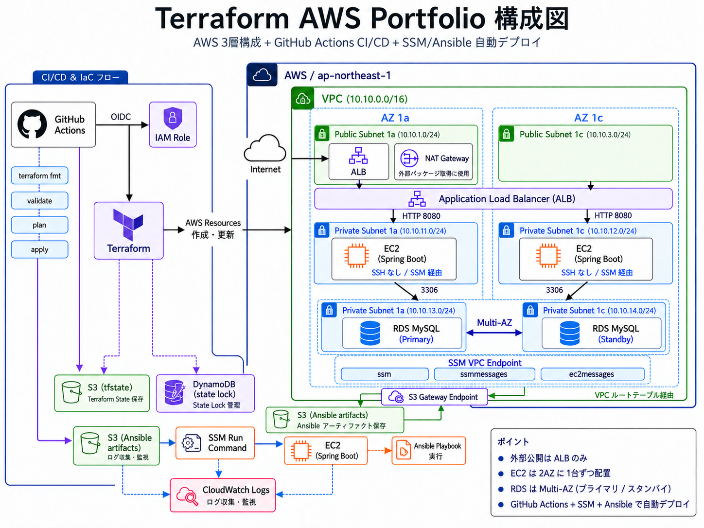

# Terraform AWS Portfolio

## 概要

Terraformを用いてAWS上にWebアプリケーション実行環境を構築したポートフォリオです。

ALB、EC2、RDSを用いた基本的な3層構成を作成し、EC2は2つのAvailability Zone（AZ）のPrivate Subnetに1台ずつ配置しています。RDSはMulti-AZ構成とし、データベース層の可用性を高めています。

GitHub ActionsによるCI/CD、SSM Run Command + Ansibleによるアプリケーション自動デプロイまで実装しています。

また、TerraformのstateはS3 + DynamoDBでリモート管理し、複数環境での運用を想定した構成にしています。

**現時点ではAuto Scaling Group（ASG）は未導入です。** EC2は2台を固定配置しており、障害時にEC2を自動補充する仕組みは実装していません。

---

## 構成



この構成では、ALBのみを外部公開し、EC2とRDSはPrivate Subnetに配置しています。

EC2はap-northeast-1a / 1cのPrivate Subnetに1台ずつ配置し、ALBから2台へ通信を振り分けています。EC2の2台は**ASGによる管理ではなく、固定台数としてTerraformで作成**しています。

RDS（MySQL）はMulti-AZ DBインスタンス構成です。通常時はプライマリがアクセスを処理し、別AZのスタンバイにデータを同期します。

GitHub ActionsからOIDCでAWSへ認証し、Terraformによるインフラ構築と、SSM Run Command + Ansibleによるアプリケーションデプロイを自動化しています。

---

## 使用技術

- Terraform
- AWS
  - VPC
  - Subnet
  - Internet Gateway
  - Regional NAT Gateway
  - VPC Endpoint
  - ALB
  - EC2
  - RDS（MySQL / Multi-AZ）
  - S3
  - DynamoDB
  - IAM
  - Systems Manager
  - CloudWatch
- GitHub Actions
- OIDC
- Ansible
- Spring Boot
- MySQL

---

## 主な実装内容

### TerraformによるAWSインフラ構築

VPC、Public Subnet、Private Subnet、ALB、EC2、RDSなどをTerraformで構築しています。

EC2は2つのAZのPrivate Subnetに1台ずつ配置し、ALBから2台へ振り分けることで、アプリケーション層の冗長性を高めています。ただし、EC2は固定2台構成であり、ASGによる自動復旧・自動スケーリングは未実装です。

RDSはMulti-AZ構成を採用し、データベース層で障害が発生した場合の自動フェイルオーバーに対応しています。

EC2とRDSはPrivate Subnetに配置し、インターネットから直接アクセスできない構成としています。外部公開はALBのみです。

EC2の複数台化に伴い、以下についても複数台構成に対応しました。

- ALB Target Group Attachment
- EC2のOutput
- CloudWatch Alarm
- GitHub Actions
- Ansible実行時に使用するEC2 Instance ID

単にEC2を2台に増やすだけでなく、EC2を参照している周辺設定まで影響範囲を確認し、構成全体として整合性が取れるよう修正しています。

---

### tfstateのリモート管理

Terraformのstate管理には、S3とDynamoDBを使用しています。

- S3：tfstateの保存
- DynamoDB：state lockの管理

これにより、ローカル環境に依存しないstate管理を行えるようにしています。

---

### GitHub ActionsによるCI/CD

GitHub Actionsを使用し、Pull Request作成時に`terraform plan`を実行し、mainブランチへのマージ後に`terraform apply`を実行する構成にしています。

AWS認証には長期アクセスキーを使わず、GitHub Actions OIDCを利用しています。

EC2の2台化に伴い、Terraform Outputから複数のEC2 Instance IDを取得し、後続のデプロイ処理で扱えるようにしています。

---

### OIDCによるAWS認証

GitHub ActionsからAWSへアクセスするために、IAM RoleとOIDCを使用しています。

IAM Roleの信頼ポリシーでは、特定のGitHubリポジトリ、mainブランチ、pull_requestからのアクセスに制限しています。

これにより、不要なリポジトリやブランチからAWSリソースを操作できないようにしています。

---

### SSM Run Command + Ansibleによる自動デプロイ

EC2はPrivate Subnetに配置し、SSHではなくAWS Systems Managerを使用して管理しています。

GitHub ActionsからSSM Run Commandを実行し、EC2上でAnsible Playbookを実行することで、Spring Bootの実行環境構築を自動化しています。

EC2の2台化後は、複数のInstance IDを取得し、それぞれのEC2に対してデプロイ処理を実行できる構成へ変更しています。

---

### VPC Endpoint / NAT Gateway構成

EC2をPrivate Subnetに配置したままSystems Managerを利用できるよう、以下のVPC Endpointを作成しています。

- `ssm`
- `ssmmessages`
- `ec2messages`
- `s3`

Interface VPC EndpointではPrivate DNSを有効化し、通常のAWSサービスエンドポイント名を使用したまま、VPC Endpoint経由でSSM関連通信を行える構成にしています。S3にはGateway型VPC Endpointを使用しています。

一方、Ansible実行時には外部リポジトリからパッケージを取得する必要があるため、インターネット向けOutbound通信には**Regional NAT Gateway**を併用しています。

Regional NAT Gatewayは、特定の1つのAZに配置するZonal NAT Gatewayと異なり、リージョン単位で利用するNAT Gatewayです。

---

### CloudWatchによる監視

EC2のCPU使用率やStatus Checkを監視するCloudWatch Alarmを設定しています。

EC2の2台化に伴い、1a / 1cの各EC2に対して個別にAlarmを作成し、どのEC2で異常が発生したか識別できるようにしています。

また、ALBについてもUnHealthyHostCountや5xx系の監視を行う構成としています。

---

## ディレクトリ構成

```text
.
├── bootstrap
│   ├── backend
│   ├── iam
│   └── s3_artifacts
├── environments
│   └── dev
├── modules
│   ├── network
│   ├── security
│   ├── app
│   ├── iam
│   └── vpc_endpoints
├── ansible
│   ├── roles
│   └── playbooks
└── tests
```

---

## 前提条件

本環境を構築する前に、bootstrap環境で以下のリソースを作成しておく必要があります。

- tfstate保存用S3バケット
- state lock用DynamoDBテーブル
- GitHub Actions用IAM Role
- EC2用IAM Role
- Ansible配布用S3バケット

---

## 実行手順

### 1. bootstrap環境の作成

```bash
cd bootstrap

terraform init
terraform plan
terraform apply
```

### 2. dev環境の作成

```bash
cd environments/dev

terraform init
terraform plan
terraform apply
```

### 3. GitHub ActionsによるCI/CD

Pull Request作成時にTerraformのCIが実行されます。

```text
Pull Request
    ↓
terraform fmt
terraform validate
terraform plan
```

mainブランチへマージするとTerraformのCDが実行され、AWSリソースが作成・更新されます。

```text
Merge to main
    ↓
terraform apply
```

その後、SSM Run CommandとAnsibleを用いてアプリケーションのデプロイを行います。

---

## 工夫した点

- EC2をPrivate Subnetに配置し、SSHを使わずSSM経由で操作する構成にした
- EC2を2つのAZに1台ずつ固定配置し、ALB配下のアプリケーション層を複数AZ構成にした
- RDSをMulti-AZ構成とし、データベース層で自動フェイルオーバーできるようにした
- EC2の複数台化に伴い、Target Group、CloudWatch Alarm、Output、GitHub Actions、Ansibleも複数台対応に修正した
- GitHub ActionsのAWS認証にOIDCを使用し、長期アクセスキーを不要にした
- tfstateをS3 + DynamoDBで管理し、ローカル環境に依存しないstate管理にした
- Terraformコードをmodule化し、network / security / app / iamなどの責務を分けた
- SSM Run CommandとAnsibleを組み合わせ、アプリケーションのデプロイを自動化した
- VPC EndpointとRegional NAT Gatewayの役割を分け、SSMのプライベート接続とPrivate EC2からのインターネット向け通信を使い分けた
- 一度構築して終わりにせず、セキュリティ・可用性・運用面から継続的に構成を改善した

---

## 学んだこと

このポートフォリオを通じて、TerraformによるAWSインフラ構築だけでなく、CI/CD、IAM、ネットワーク、SSM、監視、構成管理ツールを組み合わせた自動化の流れを学びました。

特に、Private Subnet上のEC2へSSHせずにSSMで操作する構成や、GitHub Actions OIDCによるAWS認証、EC2の複数台化に伴う周辺リソースへの影響範囲の確認などを通して、単にリソースを作るだけではなく、構成全体の依存関係を考えることの重要性を学びました。

また、Multi-AZについては、ALB・EC2・RDSそれぞれで冗長化の仕組みが異なる点を学びました。RDSは自動フェイルオーバーに対応していますが、ASGを導入していないEC2は、障害時に自動補充されないという違いがあります。

---

## 現在の冗長化状況

```text
ALB         : 複数AZに対応
EC2         : ap-northeast-1a / 1c に1台ずつ（固定2台、ASG未導入）
RDS         : Multi-AZ（プライマリ／スタンバイ、自動フェイルオーバー）
NAT Gateway : Regional NAT Gateway（リージョン単位、Private EC2のOutbound通信）
```

EC2を複数AZに配置していても、ASGを導入していないため、EC2の停止や障害に応じて自動的に台数を維持する仕組みはありません。また、RDSのフェイルオーバー時には一時的な接続断が発生する可能性があります。

---

## 今後の改善点

- Auto Scaling Group（ASG）導入によるEC2の自動補充・ヘルスチェック連携
- Regional NAT Gatewayの利用状況・コストを評価し、必要に応じて構成を見直す
- NAT Gatewayを使わずにデプロイできる構成の検証
- Ansible実行に必要なパッケージをAMIに事前インストールする構成の検討
- CloudWatch Logsやメトリクスを活用した監視・障害分析の強化
- WAF導入・ルール設計の検討
- 本番環境を想定した複数環境構成の追加
